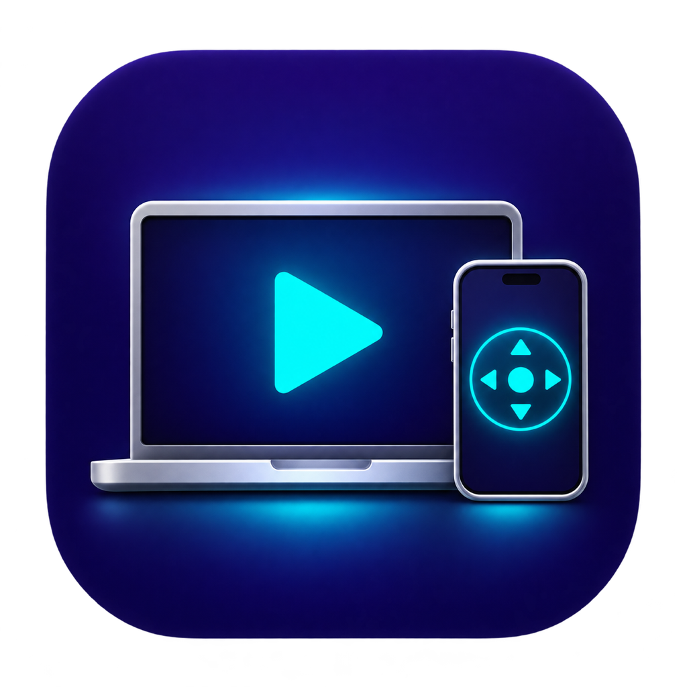
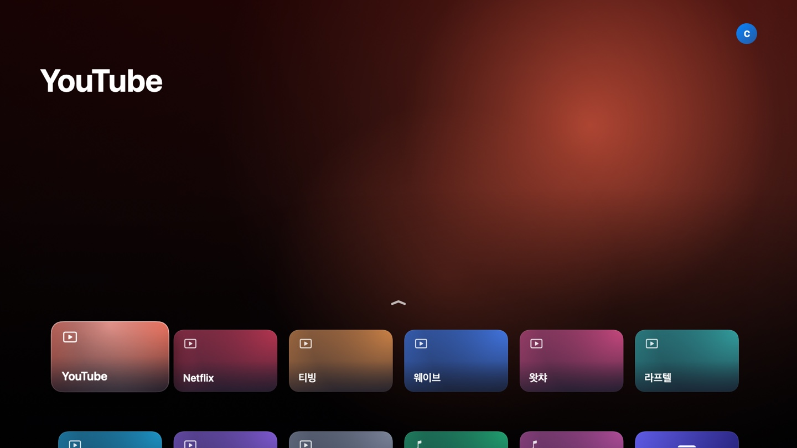
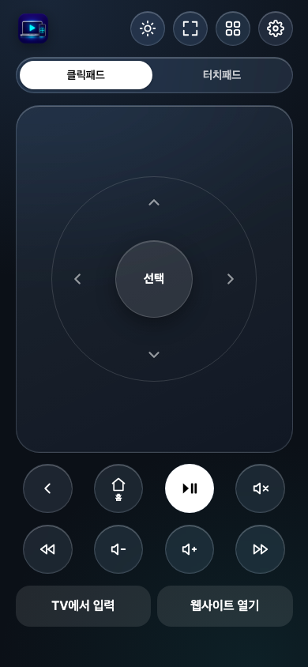

<p align="center">
  
</p>

<h1 align="center">CouchDial</h1>

<p align="center"><strong>밖에서는 노트북, 집에서는 TV.</strong></p>

CouchDial은 Mac에서 영상을 보고 아이폰을 리모컨으로 쓰는 오픈소스 macOS 앱입니다. 맥북 화면으로 바로 보거나 Mac을 모니터나 TV에 연결해 큰 화면으로 볼 수 있습니다.

[Mac용 다운로드](https://github.com/Cocomong98/MacTV-Custom/releases/latest) · [변경 기록](CHANGELOG.md)

## 왜 만들었나요?

자취방에 맥북과 모니터가 있어도, 영상을 바꾸거나 보고 싶은 구간으로 갈 때마다 맥북까지 가야 하면 큰 화면을 두고도 아이폰으로 보게 됩니다. 이미 가진 장비로 영상을 보고, 소파에서 아이폰으로 검색하고 재생할 수 있도록 CouchDial을 만들었습니다.

- **매일 쓰는 맥북으로** 밖에서는 노트북으로 쓰고, 집에 돌아오면 맥북 자체 화면이나 연결한 모니터로 영상을 볼 수 있습니다.
- **쉬고 있는 Mac으로** 안 쓰는 맥북이나 Mac mini를 영상 재생용으로 쓰고, 아이폰으로 조작할 수 있습니다.

## 앱 화면

<table>
  <thead>
    <tr>
      <th scope="col">Mac 홈 화면</th>
      <th scope="col">아이폰 리모컨</th>
    </tr>
  </thead>
  <tbody>
    <tr>
      <td></td>
      <td></td>
    </tr>
  </tbody>
</table>

## 소파에서 할 수 있는 일

- **QR로 연결하기** · 같은 Wi-Fi에서 Mac에 표시된 QR을 스캔하면 아이폰 Safari에서 리모컨이 열립니다.
- **아이폰 키보드로 검색하기** · Mac에서 검색창을 선택하고 리모컨의 **TV에서 입력**을 누르면 한글 검색어를 아이폰에서 보낼 수 있습니다.
- **보고 싶은 구간으로 이동하기** · 내장 플레이어에서 탐색할 수 있는 YouTube 영상에는 **15초 뒤로·앞으로** 버튼이 표시됩니다.
- **화면과 소리 조절하기** · 아이폰에서 전체화면으로 바꾸고 내장 스피커 음량을 조절할 수 있습니다. 밝기 조절을 지원하는 화면은 각각 조절할 수 있어서, 외장 모니터로 볼 때 맥북 화면의 밝기만 낮출 수 있습니다.
- **다른 서비스를 열었다가 이어보기** · 내장 웹 플레이어에서 홈으로 돌아오면 재생이 멈춥니다. CouchDial을 실행 중인 동안 최근 최대 세 서비스의 화면과 재생 위치를 유지합니다.

홈에서 YouTube, 넷플릭스, 웨이브, 왓챠, 티빙, 라프텔 등을 열 수 있습니다. 각 서비스의 공식 웹사이트에서 기존 계정으로 로그인합니다.

## 설치하고 연결하기

**macOS 14 Sonoma 이상**을 사용하는 Apple Silicon·Intel Mac을 지원합니다.

1. 최신 릴리스에서 `CouchDial-<버전>.dmg`를 다운로드합니다. [GitHub Releases](https://github.com/Cocomong98/MacTV-Custom/releases/latest)
2. DMG를 열고 앱을 **응용 프로그램** 폴더로 옮깁니다. 번들 파일명은 `MacTV Custom.app`이고, 실행하면 **CouchDial**로 표시됩니다.
3. Mac과 아이폰을 같은 Wi-Fi에 연결합니다. CouchDial이 로컬 네트워크 접근을 요청하면 허용하고, 화면의 QR을 아이폰으로 스캔합니다.

첫 실행에 macOS 확인 화면이 나오면 다운로드 출처와 릴리스에 함께 게시된 SHA‑256 체크섬을 확인한 뒤 Apple의 안내를 따르세요. [Mac에서 앱을 안전하게 열기](https://support.apple.com/ko-kr/102445)

외장 화면의 밝기 조절은 모니터와 연결 방식에 따라 달라지며, 일부 환경에서는 BetterDisplay가 필요합니다. [화면 및 사운드 명세](docs/UI_SPEC.md#아이폰-리모컨)

### Homebrew 설치

```bash
brew tap Cocomong98/mactv https://github.com/Cocomong98/MacTV-Custom.git
brew install --cask Cocomong98/mactv/mactv-custom
```

### 업데이트

CouchDial 0.4.0부터 **설정 → 앱 정보 → 업데이트 확인**에서 새 버전을 확인하고 **업데이트 및 재시작**으로 설치할 수 있습니다. 0.3.1 이하에서는 DMG 또는 Homebrew로 먼저 업데이트하세요.

```bash
brew update
brew upgrade --cask Cocomong98/mactv/mactv-custom
```

## 개발

소스에서 공개판을 빌드하고 검증하려면 저장소 루트에서 실행합니다.

```bash
./build.sh --release
open "build/MacTV Custom.app"
bash scripts/test-custom.sh
```

- [기여 가이드](CONTRIBUTING.md) · [개발 로드맵](docs/ROADMAP.md) · [테스트 계획](docs/TEST_PLAN.md) · [브랜치와 배포](docs/RELEASING.md)
- 버그나 사용 중 겪은 문제는 [CouchDial 이슈](https://github.com/Cocomong98/MacTV-Custom/issues)에 남겨 주세요.

## 원본 프로젝트와 라이선스

CouchDial은 Arunprakaash가 만든 Mac TV v0.22에서 출발했습니다. 원본 커밋 `50c9fd90f2f9f373cfdb5aed1a6adac15b369051`과 Git 이력을 보존하며, 소스는 MIT 라이선스로 공개합니다. [원본 Mac TV v0.22](https://github.com/Arunprakaash/mac-tv/tree/v0.22) · [MIT 라이선스](LICENSE)
